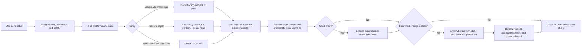

# Engineering interface thorough redesign plan

**Status:** Implemented first reference draft; iterate through testing  
**Version:** 0.2  
**Date:** 2026-08-20  
**Supersedes for further iteration:** the category-led screen compositions,
which remain retained in Figma as a reversible baseline

Implementation is recorded in `FIGMA_IMPLEMENTATION.md`. The first reference
draft consists of nine 1,440 × 900 states in the Figma section
`Redesign · Inspect → Diagnose → Change` (`46:458`).

## 1. Redesign outcome

Replace the current collection of category dashboards with one spatial
engineering workbench organized around a clear investigation flow:

```text
Orient → Notice → Locate → Understand → Prove → Change → Verify
```

The stable platform schematic is the user's mental map. Compute, connectivity,
software, time, subsystems, cameras, and external integration become lenses on
that map. Exact values, configuration, logs, and commands appear only when the
user selects a relevant object or asks for evidence.

The redesign must feel:

- more visual than textual;
- denser without becoming noisy;
- calm at a glance and precise on demand;
- organized around a diagnostic question, not around data categories;
- faithful to the actual three-computer, LAN, CAN, subsystem, camera, uplink,
  container, VPN, and time-synchronization architecture.

## 2. Diagnosis of the current reference screens

The current screens are useful as a component experiment, but not as the
product-flow target.

| Current behavior | Why it fails | Redesign response |
| --- | --- | --- |
| Six domain categories dominate the left navigation | The user must decide where a problem belongs before understanding it | Use task modes: Inspect, Diagnose, Change |
| Overview, Compute and Connectivity repeat nearly the same card composition | Pages feel like category skins rather than steps in an investigation | Preserve one platform geography and change the active lens |
| The “dependency stage” is four equal summary cards | It does not explain the actual LAN, Intel/CAN, subsystem or uplink relationships | Replace it with a real platform schematic |
| Two large trace cards are always visible | They consume space before the user has selected a question or object | Show compact comparative signals; open detailed traces on selection |
| The inspector is permanently open | A large portion of the screen explains an object even when nothing is selected | Collapse it until selection; let the attention rail transform into the inspector |
| The diagnostics drawer is permanently expanded | Evidence competes with Glance information | Keep a compact evidence strip; expand it only during investigation |
| Root-cause text is repeated in issue, inspector and drawer | Duplication creates density without adding information | One issue summary focuses the visual path; detail lives in the inspector and evidence drawer |
| Exact CPU, temperature, p95, sampling and timestamp data appear at Glance | The first viewport reads like a report rather than a state overview | Apply a strict information budget and progressive disclosure |
| The 1,300 px page requires scrolling despite sparse modules | Space is allocated by card size rather than task priority | Fit the default 1,440 × 900 state above the fold |
| Healthy and affected objects have similar card weight | The user scans every object instead of seeing one condition immediately | Put state directly on the schematic and visually suppress normal objects |

## 3. Product model: tasks first, domains second

### Primary task modes

The persistent navigation should contain three primary modes:

1. **Inspect** — understand current platform structure and state.
2. **Diagnose** — investigate an issue across synchronized evidence.
3. **Change** — review and perform permitted configuration or platform actions.

Settings, environment selection, and user/permission context remain utilities.
They do not become fourth-level data destinations.

### System lenses

Inside Inspect, a compact layer control changes what the same platform map
emphasizes:

- **Physical** — computers, cameras, CAN and physical subsystems;
- **Network** — WiFi, cellular, VRRP/keepalived, LAN, CAN and Tailscale;
- **Software** — Docker containers, ownership and runtime dependencies;
- **Time** — chrony sources, participants, offsets and correlation confidence;
- **Integration** — fleet-manager API/agent boundary and the selected path.

The lens changes visual emphasis and available annotations. It must not
rearrange the stable positions of Intel, Jetson 1, Jetson 2, LAN or CAN.

### Why categories become lenses

An engineer diagnosing a motor-drive problem may need the physical CAN path,
the Intel-hosted runtime, a container restart, clock alignment and an external
API event in one investigation. Requiring page navigation between category
dashboards breaks that causal chain. Lenses let the user reveal the relevant
relationship without losing spatial context.

## 4. Canonical user flow



### Flow invariants

- Selecting any representation of an object opens the same inspector.
- Switching lenses never clears the selection.
- Opening evidence never clears object, path, filters or time window.
- Entering Change preserves the diagnosis that motivated the change.
- Returning to Inspect restores the platform map and focused path.
- Safety state remains visible through every step.

## 5. Information hierarchy and budget

### Tier 0 — persistent context

Always visible:

- active robot name and immutable identifier affordance;
- connection and freshness;
- safety state and provisional safety-stop control;
- global search;
- current mode and permission context.

### Tier 1 — Glance

Visible without selection:

- actual platform topology;
- state of each major object and important connection;
- one dominant abnormal or selected path;
- quiet global clock-correlation confidence;
- at most one compact condition statement;
- compact comparison of the three compute nodes;
- most recent consequential change.

### Tier 2 — Focus

Visible after selection:

- exact object identity and health reason;
- one or two values that explain the state;
- direct upstream and downstream dependencies;
- freshness and source;
- available evidence;
- eligible contextual actions.

### Tier 3 — Evidence

Visible only after request:

- detailed traces;
- synchronized event/log timeline;
- raw messages and errors;
- configuration diff;
- versions, ports, addresses and timestamps;
- causal confidence and source detail;
- export and audit context.

### Tier 4 — Change

Visible only in a deliberate workflow:

- intended change;
- target and scope;
- preconditions, permission and interlocks;
- expected result;
- request, acknowledgement and observed result;
- rollback/recovery where applicable;
- audit record.

### Glance information budget

An unselected object may show only:

1. name or recognizable label;
2. health/state;
3. one condition signal when it improves orientation.

Exact percentages, temperatures, p95/min/max, sampling interval, precise
timestamps, version strings and verbose dependency text do not belong on the
default overview unless they themselves are abnormal.

## 6. Reference desktop layout

The first redesign target is 1,440 × 900. It should not require scrolling in
the default Inspect state.

```text
┌────────────────────────────────────────────────────────────────────────────┐
│ 56 px global bar: robot · live/freshness · search · safety · permission    │
├───────┬───────────────────────────────────────────────────────┬────────────┤
│       │ compact scope bar: Inspect · lens · time · one fact  │ attention  │
│ 72 px ├───────────────────────────────────────────────────────┤ rail       │
│ task  │                                                       │ 288–320 px │
│ rail  │            stable platform schematic                 │            │
│       │   uplinks → LAN → Intel / Jetsons → CAN/subsystems   │ issue or   │
│ Inspect│                                                       │ selected   │
│ Diagnose├──────────────────────────────────────────────────────┤ object     │
│ Change│ three-node comparison   │ recent consequential change │            │
│       ├───────────────────────────────────────────────────────┴────────────┤
│       │ collapsed evidence strip · current scope · expand                 │
└───────┴────────────────────────────────────────────────────────────────────┘
```

### Space allocation

- global bar: 56 px;
- task rail: 72–80 px;
- workbench padding: 16–20 px;
- primary schematic: approximately 65–70% of workbench width and 480–540 px
  high;
- attention rail: 288–320 px when needed;
- comparison/change strip: 160–190 px high;
- collapsed evidence strip: 40–48 px;
- expanded inspector: 360–400 px only after selection when the content needs
  more than the attention rail;
- expanded evidence drawer: 240–320 px, overlaying or compressing the lower
  workbench without changing system geography.

### Adaptive attention rail

- **Healthy/no selection:** a narrow confirmation and recent-change summary;
  the schematic gains width.
- **Degraded/no selection:** ranked root condition and affected scope.
- **Selected object:** transforms into the object inspector.
- **Action pending:** transforms into acknowledgement/result state.

This prevents three permanent right-side panels from competing for space.

## 7. Primary visual instrument

The stable platform schematic replaces the current card-based dependency stage.
Its baseline geography follows `SYSTEM_VISUALIZATION_SPEC.md`:

```text
off-board integration / Tailscale / WiFi / cellular
                         ↓
             shared uplink · VRRP/keepalived
                         ↓
════════════════════ on-board LAN ════════════════════
       │                    │                    │
     Intel               Jetson 1             Jetson 2
       │
      CAN
  ┌────┼────────┬─────────┬──────────┐
charge battery motor   8× power    gas ADCs       cameras · attachment TBD
```

### At Glance

- Normal objects use restrained neutral geometry.
- A degraded object and its consequential path use orange.
- The selected object uses a yellow focus bracket or cursor.
- Fault uses red in addition to icon/text.
- Stale/unknown objects use muted/dashed treatment.
- The schematic contains small live instruments only where they help compare
  state: compact load band, link pulse, bus error mark, clock-skew indicator.

### On selection

- Neighboring relationships gain labels.
- Unrelated detail dims but the whole system remains visible.
- The attention rail explains “why this state,” “what is affected,” and “what
  evidence is available.”
- A lens switch may add containers, VPN paths or clock relationships without
  moving nodes.

## 8. Key scenario storyboards

### Scenario A — healthy platform

1. User opens the robot.
2. Header confirms current connection, freshness and safety state.
3. Schematic is neutral and compact; no issue queue dominates.
4. Three-node comparison shows shape/trend rather than exact detail.
5. Recent change is visible as one compact strip.

Success: the user understands the architecture and sees “nothing needs
attention” without reading a grid of healthy cards.

### Scenario B — motor-drive degradation

1. Motor-drive node and relevant CAN path appear orange.
2. Attention rail states consequence, likely source and age in one sentence.
3. Selecting the motor-drive focuses the node and opens its inspector.
4. Inspector shows exact drive state, CAN errors and affected power/control
   relationships.
5. Evidence drawer opens on the same time window if requested.

Success: the responsible object and propagation path are visible before any
detailed numbers are read.

### Scenario C — uplink failover

1. User chooses Network lens or selects the uplink condition.
2. WiFi, cellular, keepalived/VRRP ownership, LAN and Tailscale path become
   primary.
3. The current and standby path are visually distinct.
4. Inspector shows failover reason, last transition and path health.

Success: the user sees one end-to-end path rather than unrelated interface
cards.

### Scenario D — container/runtime issue

1. Search finds a container, or the user selects a compute node and switches to
   Software lens.
2. Docker workloads appear within the three stable host lanes.
3. The selected container and hardware/network dependencies become visible.
4. Exact resource and restart information appears in the inspector.

Success: container placement and impact are understood without leaving the
platform map.

### Scenario E — unreliable event correlation

1. Chrony state or offset becomes abnormal.
2. Time lens shows the participating nodes and source relations.
3. Timeline/evidence is marked low confidence before causal ordering is shown.

Success: the interface does not claim a precise root-cause order when clocks
are unsynchronized.

### Scenario F — deliberate change

1. User reaches Change from a selected object or explicit navigation.
2. Diagnosis context remains visible.
3. Request, target, eligibility and expected result are reviewed.
4. UI distinguishes sent request, acknowledgement and observed result.

Success: an action never looks complete merely because the command was sent.

## 9. Proposed Figma screen set

The redesign should be evaluated as a connected storyboard, not isolated pages.

| Order | Screen/state | Purpose |
| ---: | --- | --- |
| 1 | Inspect · healthy | Establish the compact default and stable mental map |
| 2 | Inspect · degraded motor drive | Test instant visual location and affected path |
| 3 | Inspect · selected subsystem | Test attention-rail-to-inspector transition |
| 4 | Diagnose · evidence expanded | Test synchronized evidence without losing geography |
| 5 | Inspect · Network lens | Test WiFi/cellular/VRRP/LAN/Tailscale path |
| 6 | Inspect · Software lens | Test Docker placement across all three computers |
| 7 | Diagnose · clock uncertainty | Test chrony and causal-confidence handling |
| 8 | Change · review and acknowledgement | Test safe, auditable action progression |
| 9 | Inspect · stale/disconnected | Test partial evidence and disabled actions |

The first four form the critical path and must be approved before the remaining
states are built.

## 10. Component strategy

Build components around interaction and system grammar, not data categories:

### Platform schematic

- compute node;
- physical subsystem node;
- camera node;
- external integration node;
- unknown/TBD attachment;
- LAN/CAN bus spine and attachment point;
- physical, logical, VPN, time and unknown edge types;
- orange affected-path state;
- yellow selection bracket/current probe;
- compact inline signal marks.

### Workbench

- task rail item;
- lens switcher;
- compact robot/scope bar;
- adaptive attention rail;
- object inspector sections;
- three-node comparison strip;
- consequential-change strip;
- collapsed and expanded evidence drawer;
- synchronized timeline with clock-confidence state.

### Change and control

- eligibility/precondition block;
- command review;
- request/acknowledgement/observed-result progression;
- audit record;
- provisional safety-stop lifecycle as a separately reviewed family.

Avoid creating separate “Compute card,” “Network card,” and “Subsystem card”
families when they can share one object-node or inspector grammar.

## 11. Figma implementation phases

### Phase 0 — baseline and content contract

- Preserve current screens as a clearly labelled baseline.
- Confirm the platform model and list every known/unknown attachment.
- Define representative healthy, degraded, stale and disconnected data.
- Confirm which values are authoritative enough for Glance.

**Exit gate:** no invented host, route, CAN, camera, chrony or container facts.

### Phase 1 — greyscale flow skeleton

- Create a separate redesign exploration page.
- Build the compact shell, task rail, scope bar, schematic region, adaptive
  attention rail and collapsed evidence strip.
- Compose the first four critical-path frames in greyscale.
- Connect them as a prototype.

**Exit gate:** users can follow Orient → Notice → Locate → Understand → Prove
without relying on color or explanatory narration.

### Phase 2 — schematic grammar

- Build stable node, bus, edge, focus and affected-path components.
- Add Physical, Network, Software, Time and Integration lenses.
- Test long labels, unknown attachments and several simultaneous minor states.

**Exit gate:** object types and edge meanings remain unambiguous in greyscale.

### Phase 3 — progressive detail and evidence

- Build the adaptive attention rail and object inspector transition.
- Build collapsed/expanded evidence behavior and synchronized timeline.
- Add search-driven focus and state preservation.

**Exit gate:** exact data is reachable in one disclosure without polluting the
default overview.

### Phase 4 — Change workflow

- Add explicit change review, permission, acknowledgement, observed result,
  recovery and audit states.
- Keep safety-stop work provisional until its separate review gates close.

**Exit gate:** no command is confused with its physical result.

### Phase 5 — visual identity

- Apply the Signal Instrumentation chassis, low-relief edge system and
  controlled floating selection surfaces.
- Use yellow for current/selected/action and orange for degradation.
- Add restrained spatial atmosphere only after hierarchy succeeds without it.

**Exit gate:** passes the reference-fidelity and greyscale gates.

### Phase 6 — validation and promotion

- Run scenario walkthroughs with platform/embedded/service engineers.
- Test 1,440 × 900 and larger engineering viewports.
- Test keyboard focus, long IDs, stale data and color-independent state.
- Revise components and then promote the approved redesign to
  `02 Engineering Interface`.
- Retain the previous implementation as hidden or archived baseline.

## 12. Efficiency and cognition acceptance criteria

The redesign is successful when:

- the default 1,440 × 900 Inspect screen requires no page scrolling;
- an engineer identifies the dominant abnormal object in under two seconds;
- the Intel/LAN/CAN/Jetson/subsystem structure is understood in under five
  seconds without reading a paragraph;
- the selected object's exact evidence is reachable in one additional
  disclosure;
- at least 65% of the primary workbench area carries meaningful system
  structure or signals;
- no unselected schematic object shows more than three Glance facts;
- normal objects remain visible but do not compete with the affected path;
- only one selection/current path owns yellow at a time;
- an orange degraded object remains distinguishable from yellow selection;
- the three computers can be compared without changing pages;
- the evidence drawer and inspector are absent or compact until needed;
- physical, logical, VPN, time and unknown relationships cannot be confused;
- switching lenses preserves object positions, selection and time context;
- no fleet, mission, autonomy, SLAM, navigation or teleoperation workflow
  appears.

## 13. Information required before detailed implementation

The low-fidelity layout can begin with explicit unknowns, but the following
facts are required before high-fidelity details:

1. hostnames and intended roles of the three computers;
2. camera host/transport relationships;
3. exact VRRP/keepalived participant and uplink behavior;
4. GPIO-to-power-domain mapping and command feedback;
5. CAN protocol/node identity and health evidence;
6. representative Docker container placement and ownership;
7. chrony roles and acceptable offset;
8. Tailscale endpoint and route behavior;
9. one representative healthy dataset and two realistic failure stories;
10. approved terminology and behavior for safety-related controls.

Unknowns should not block the greyscale flow prototype. They must remain
visually marked and must not be replaced by invented specificity.

## 14. Decisions requested before implementation

Approve or revise:

1. task-led navigation: **Inspect / Diagnose / Change**;
2. domain categories becoming lenses rather than primary pages;
3. 72–80 px task rail replacing the 224 px category navigation;
4. stable platform schematic as the dominant default instrument;
5. adaptive attention rail replacing the always-open inspector;
6. collapsed evidence strip replacing the always-open diagnostics drawer;
7. strict Glance information budget;
8. first critical storyboard: healthy → degraded → selected → evidence.
