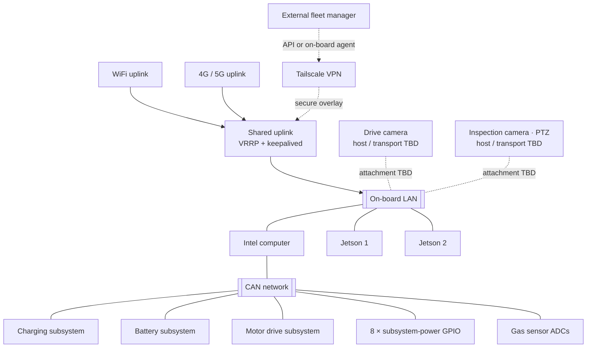
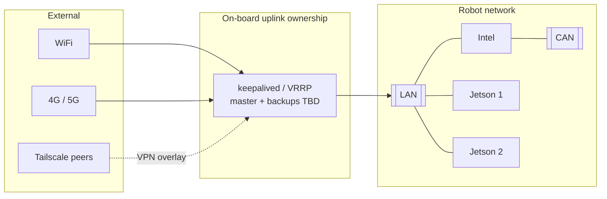
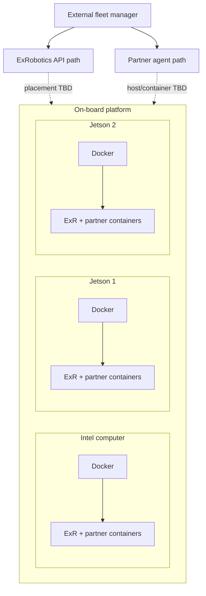
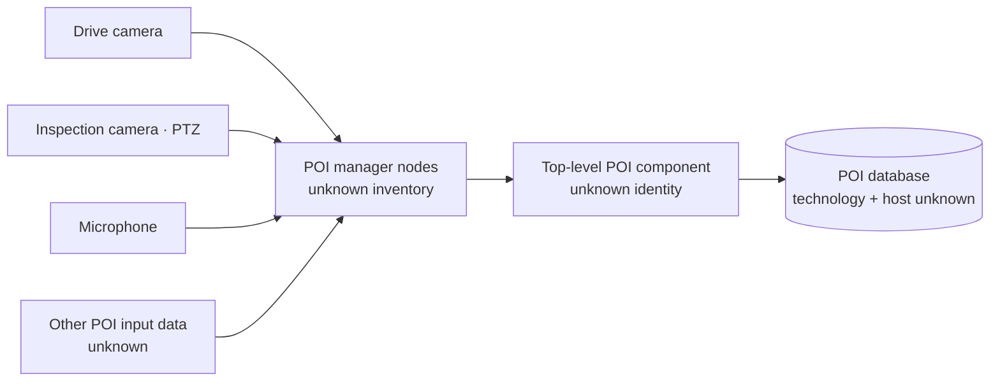

# ExRobotics on-board platform system model

**Status:** Evolving factual model; incomplete by design  
**Version:** 0.2  
**Date:** 2026-08-20  
**Machine-readable source:** `../data/platform-system.yaml`

## 1. Purpose and authority

This document records the robot platform facts that should drive the
engineering interface. It is a design input, not an electrical drawing,
network configuration, safety case, or deployment manifest.

The YAML source is authoritative for stable IDs, inventory, relationships, and
explicit unknowns. This document explains the same system for people and shows
the diagrams that should shape later interface work.

Use three truth labels when extending the model:

- **Stated** — supplied directly by a platform owner or authoritative source;
- **Verified** — checked against machine configuration or implementation;
- **Unknown** — needed for design but not yet established.

Never convert an unknown into an assumption merely to make a diagram look
complete.

## 2. Platform at a glance

The robot has three on-board computers: one Intel computer and two NVIDIA
Jetsons. All three share an on-board LAN. The Intel computer is the gateway to
the CAN network, behind which sit the charging, battery, motor-drive, power-I/O,
and gas-sensing domains.

Dashed camera edges deliberately mean that host and transport are unknown. The
diagram does not claim that the cameras are Ethernet devices.

## 3. Inventory

### Compute

| Stable ID | Object | Known facts | Still unknown |
| --- | --- | --- | --- |
| `compute.intel` | Intel computer | On LAN; hosts CAN attachment; runs Docker workloads | model, hostname, IP, OS, resources, CAN adapter |
| `compute.jetson_1` | Jetson 1 | On LAN; runs Docker workloads | Jetson model, hostname, IP, role, resources |
| `compute.jetson_2` | Jetson 2 | On LAN; runs Docker workloads | Jetson model, hostname, IP, role, resources |

Each node runs several Docker containers belonging to ExRobotics and partners.
Container placement, ownership, dependencies, ports, versions, health checks,
and restart policies are not yet inventoried.

### Physical subsystems and I/O

| Stable ID | Object | Connection | Design-relevant state to discover |
| --- | --- | --- | --- |
| `subsystem.charging` | Charging subsystem | CAN through Intel | mode, availability, current/voltage, errors, inhibit reason |
| `subsystem.battery` | Battery subsystem | CAN through Intel | state of charge, voltage/current, temperature, contactor and faults |
| `subsystem.motor_drive` | Motor drive subsystem | CAN through Intel | enabled state, power, temperatures, faults and inhibit chain |
| `io.power_gpio_bank` | 8 power-control GPIOs | CAN-side domain; exact controller unknown | channel mapping, command state, observed state and interlocks |
| `sensor.gas_adc` | Gas sensor ADCs | CAN-side domain | channels, units, calibration, thresholds, validity and alarm state |

The UI must separate a requested GPIO state from an observed power-domain
state. A switch-looking control must not imply that power changed merely
because a command was sent.

### Motor protection: Drive Stall

`protection.drive_stall` is a stated, latched protection state of the motor
drive. It activates after motor overload and requires intentional manual
deactivation. It does not automatically clear when the overload observation
ends.

Still unknown are the authoritative controller/signal, affected motor or
channel granularity, deactivation prerequisites, whether deactivation is local
or remotely commandable, and whether a separate enable/restart action follows.
Drive Stall is not a synonym for the provisional Safety Stop function; both
states and their recovery lifecycles must remain independently observable.

### Vision hardware

| Stable ID | Object | Known facts | Still unknown |
| --- | --- | --- | --- |
| `vision.drive_camera` | Drive camera | camera exists | host, transport, stream health, controls |
| `vision.inspection_camera` | Inspection camera | PTZ controllable | host, transport, PTZ protocol, limits, presets, stream health |

The cameras belong in hardware and connectivity topology. Their imagery may be
shown as diagnostic evidence, but this does not turn the interface into a
teleoperation or autonomy product.

### POI audio input

| Stable ID | Object | Known facts | Still unknown |
| --- | --- | --- | --- |
| `audio.microphone` | POI capture microphone | microphone input belongs to the POI Capture System | host, transport, channel count, device identity, health source |

## 4. Connectivity and platform services

### Network layers

1. **Physical access:** WiFi and 4G/5G provide external links.
2. **On-board high availability:** keepalived/VRRP lets the on-board computers
   share an internet uplink. Participants, protected address/route, priority,
   and failover policy remain unknown.
3. **On-board LAN:** joins the Intel and both Jetsons.
4. **Secure overlay:** Tailscale is the VPN technology. Endpoint placement,
   advertised routes, exit-node behavior, and peer health remain unknown.
5. **Field bus:** CAN attaches to the Intel computer and connects the named
   subsystem and I/O domains.

### Time synchronization

Chrony synchronizes platform time across the compute nodes. Exact source,
server/client roles, stratum, offset thresholds, and holdover behavior must be
added. Time health is cross-cutting because it determines whether logs, events,
traces, and causal timelines can be correlated.

The interface should eventually expose:

- synchronization state per compute node;
- current offset and uncertainty;
- selected source and reachability;
- last successful update;
- a prominent correlation warning if nodes disagree beyond the accepted limit.

## 5. Software and external integration

Fleet-manager connectivity is visible as an integration boundary, agent/API
health, and network dependency. Fleet inventory, dispatch, mission state, and
operator workflows remain outside this interface.

### Software subsystem inventory

The following software domains are now stated design inputs. Placement and
runtime details remain unknown unless noted.

| Stable ID | Subsystem | Known responsibility | Required observability to establish |
| --- | --- | --- | --- |
| `software.poi_capture` | POI Capture System | cameras, microphone, manager nodes, top-level component, POI input data and database | pipeline health, child health, data availability, capture results, database health/errors |
| `software.can_subsystem` | CAN software subsystem | monitors/integrates the Intel-attached CAN domain | expected messages present, expected rates, bus errors/load, per-subsystem response time |
| `software.api_agent` | API Agent | on-board external-integration agent | placement, version, endpoint/contract, connection, authentication posture, latency and errors |
| `software.cybersecurity` | Cybersecurity monitoring | observes unauthorized login attempts | authoritative log sources, attempt outcome, target, aggregation, retention and privacy policy |
| `middleware.ros2_dds` | ROS 2 and DDS middleware | connects software across the three compute nodes | expected graph, participants, topics, QoS, discovery, delivery quality and diagnostics |

Every software subsystem is expected to expose ROS 2 diagnostics when that
interface exists. The UI requirement does not prove that diagnostics are
currently implemented; exact node names, diagnostic paths and conventions must
be inventoried.

### POI Capture System

POI Capture is modelled as one top-level software subsystem with child inputs
and services rather than as unrelated camera and database cards.

The diagram describes required functional relationships, not verified runtime
placement. A selected failed capture should eventually reveal which input,
manager, top-level component or database operation caused the result.

### Requested system observability

Across the Intel and Jetson computers, the interface must obtain sources for:

- CPU utilization and attribution;
- GPU utilization and attribution on applicable nodes;
- receive/transmit network throughput with interface errors and drops;
- filesystem capacity, used/free space, I/O posture and storage/device health.

These are requested observations, not proof that one telemetry stack already
provides them. Sources, cadences, stale windows and thresholds remain unknown.

## 6. Canonical relationship paths

These paths should be reusable in topology, search, inspector, and diagnostics:

- `subsystem → CAN → Intel → LAN → uplink → external integration`;
- `container → compute node → LAN → peer or external service`;
- `camera → attachment TBD → compute/LAN → consuming container`;
- `compute node → chrony relation → time source`;
- `WiFi or cellular → keepalived/VRRP ownership → LAN`;
- `fleet-manager API or agent → Tailscale/network path → on-board runtime`.
- `motor overload → Drive Stall latch → motor-drive inhibition → manual
  deactivation lifecycle`;
- `camera/microphone/data → POI manager nodes → top-level POI component → POI
  database`;
- `software subsystem → ROS node/topic → DDS participant → container → compute
  node → LAN`;
- `CAN message/response observation → CAN software subsystem → Intel → bus →
  physical subsystem`.

Physical connection, logical dependency, observed traffic, and ownership must
be separate edge types even when they share endpoints.

## 7. Extension workflow

When adding information:

1. Update `data/platform-system.yaml` first using an existing stable ID or a
   new namespaced ID.
2. Mark the provenance and leave unavailable values as `unknown`.
3. Add or revise the human explanation and Mermaid diagram here.
4. Update `SYSTEM_VISUALIZATION_SPEC.md` only when the new fact changes how a
   view should be spatially encoded.
5. Record a design decision only when the change establishes a reusable rule.

Do not store live measurements or secrets in this model. Addresses, serial
numbers, credentials, and deployment-specific values should come from a
separate runtime or environment inventory when that source exists.

## 8. Priority questions for the next documentation pass

1. Exact hostnames, models, addresses, OS versions, and intended roles.
2. LAN switch/port topology and WiFi/cellular routing/failover behavior.
3. CAN adapter, protocol, node IDs, bitrate, and subsystem health sources.
4. Camera host, transport, stream, and PTZ-control paths.
5. GPIO channel-to-power-domain mapping and command/feedback semantics.
6. Chrony sources, roles, thresholds, and clock-fault behavior.
7. Docker container inventory, ownership, placement, dependencies, and health.
8. Tailscale endpoints, routes, peers, and observable tunnel state.
9. Fleet-manager API/agent placement and responsibility boundary.
10. Drive Stall authority, state source, affected scope, recovery prerequisites
    and local/remote deactivation semantics.
11. POI Capture node inventory, data inputs, microphone path, database, capture
    stages and health ownership.
12. Expected CAN messages/rates and subsystem response-time contracts.
13. API Agent placement, endpoint/contract and observable health.
14. Unauthorized-login sources, outcome semantics, retention and privacy.
15. ROS 2 distribution, DDS implementation/domain, expected graph, QoS and
    diagnostic conventions.
16. CPU/GPU/network/storage telemetry sources, cadences and thresholds.
