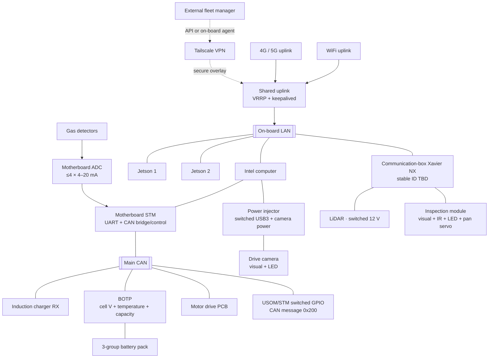
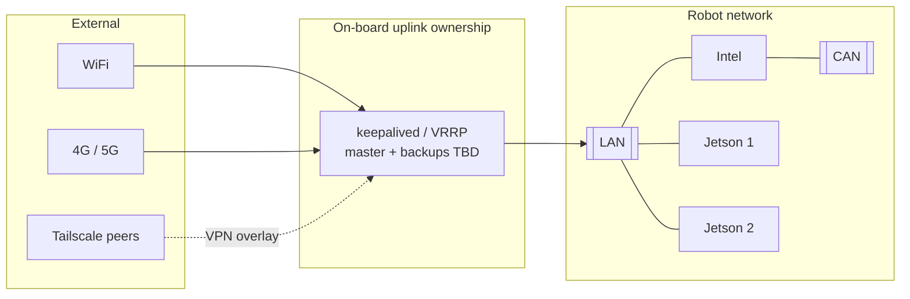
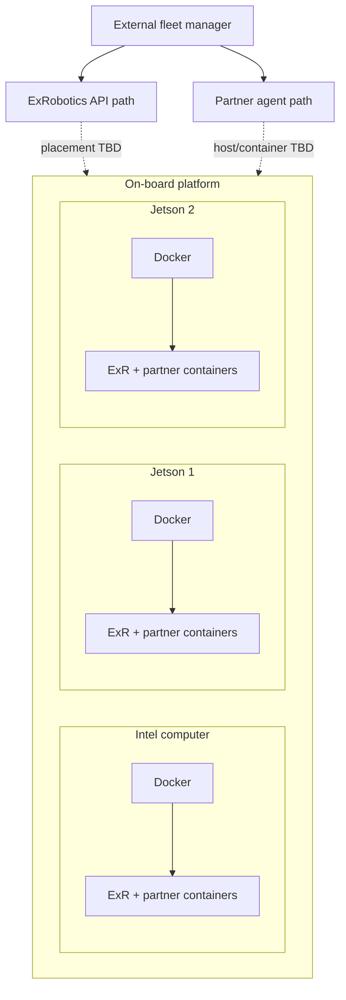
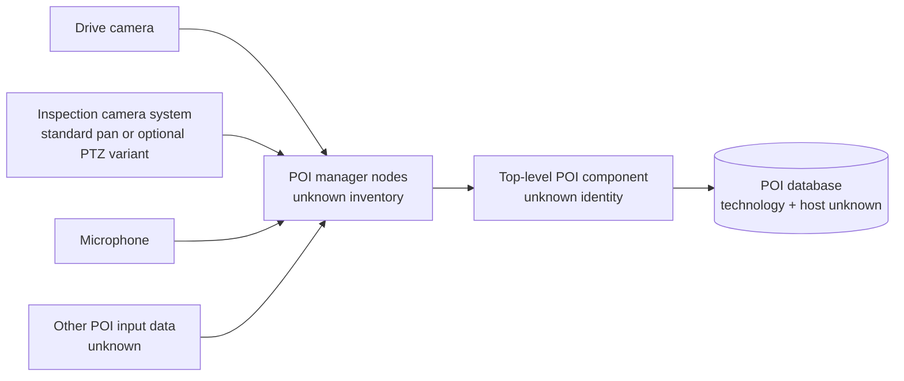

# ExRobotics on-board platform system model

**Status:** Evolving factual model; incomplete by design
**Version:** 0.3
**Date:** 2026-08-22
**Machine-readable source:** `../data/platform-system.yaml`

## 1. Purpose and authority

This document records the robot platform facts that should drive the
engineering interface. It is a design input, not an electrical drawing,
network configuration, safety case, or deployment manifest.

The YAML source is authoritative for stable IDs, inventory, relationships, and
explicit unknowns. This document explains the same system for people and shows
the diagrams that should shape later interface work.

Use three truth labels when extending the model:

- **Stated** — supplied directly by a platform owner or authoritative source;
- **Verified** — checked against machine configuration or implementation;
- **Unknown** — needed for design but not yet established.

Never convert an unknown into an assumption merely to make a diagram look
complete.

This revision incorporates two supplied references:

- `Electrical drawing ExR-2 -overview.drawio.pdf`, a confidential two-page
  drawing exported on 2023-11-08, supplies component containment, electrical
  and data paths, configuration tiers, switching maps and relative message
  rates;
- `ExR-2 harware overview_1.pptx.pdf` supplies exterior and assembly context,
  but the attached one-page PDF is a browser capture showing only the cover,
  one unlabelled assembly slide and the top of the next slide.

Facts from these documents are labelled **reference-documented** until their
hardware revision and presence on the current robot are checked. In
particular, the drawing's “minimal”, “standard”, “optional” and “special”
equipment categories are configuration possibilities, not an as-built bill of
materials.

## 2. Platform at a glance

The current platform statement names three on-board computers: one Intel
computer and two NVIDIA Jetsons. The electrical reference identifies both
Jetsons as Xavier NX devices, but it does not establish which stable ID is the
Xavier inside the communication box. All three share an on-board LAN. The
reference shows a 1 GigE Intel-to-Xavier link and an optional Ethernet switch;
the exact current three-node topology is still unknown.

The Intel sits in the electronics box. A motherboard STM forms the documented
main-CAN attachment and switching path. The main CAN carries battery, induction
charger and motor-drive information and commands. Gas detectors are not shown
as direct CAN nodes: up to four 4-20 mA detector signals enter the motherboard
ADC, after which their values reach the Intel through the motherboard path.

One Xavier NX sits in the communication box with WiFi, a 4G/LTE modem, power
control and a status indicator. That Xavier switches 12 V LiDAR power and 36 V
inspection-camera power. The standard drive-camera path instead reaches the
Intel over switched USB3 through the electronics-box power injector.

The detailed peripheral edges are reference-documented functional paths, not
confirmation of the current as-built robot. Optional front/rear cameras and a
THK PTZ replacement exist as variants; they are described below rather than
drawn as simultaneously installed devices.

## 3. Inventory

### Compute

| Stable ID | Object | Known facts | Still unknown |
| --- | --- | --- | --- |
| `compute.intel` | Intel computer | On LAN; in electronics box; attached to motherboard STM, USB2 peripherals and switched-USB3 power injector; runs Docker workloads | model, hostname, IP, OS, resources, exact STM/CAN interface semantics |
| `compute.jetson_1` | Jetson 1 | NVIDIA Xavier NX; on LAN; runs Docker workloads | hostname, IP, OS, resources and whether this is the communication-box Xavier |
| `compute.jetson_2` | Jetson 2 | NVIDIA Xavier NX; on LAN; runs Docker workloads | hostname, IP, OS, resources and whether this is the communication-box Xavier |

Each node runs several Docker containers belonging to ExRobotics and partners.
Container placement, ownership, dependencies, ports, versions, health checks,
and restart policies are not yet inventoried.

### Physical subsystems and I/O

| Stable ID | Object | Connection | Design-relevant state to discover |
| --- | --- | --- | --- |
| `subsystem.charging` | Induction charger | Main CAN through motherboard STM/Intel; independent charger powers up when properly docked | units, exact states, update rates, fault contract and current installation |
| `subsystem.battery` | Three-group battery pack | BOTP on main CAN; per-group voltage and temperature; capacity estimate | thresholds, contactor, current, estimator quality, fault and recovery semantics |
| `subsystem.motor_drive` | Motor drive PCB and motors | Main CAN through motherboard STM/Intel; shared documented switch channel with optional zippermast | enabled/observed power, temperatures, faults, Drive Stall source and inhibit chain |
| `io.power_gpio_bank` | USOM/STM switch bank | CAN message `0x200`; 2023 table enumerates GPIO 0–8 | reconcile nine table rows with the stated eight channels; command/observed state, power feedback and interlocks |
| `io.communication_box_gpio` | Xavier/Quark switch bank | Local to communication-box Xavier | requested/observed 12 V LiDAR, 36 V inspection camera and status-indicator state |
| `sensor.gas_adc` | Gas detector ADC inputs | Up to four 4–20 mA channels on motherboard; not a direct CAN attachment | installed detector/channel map, units, calibration, validity, thresholds and alarm latching |
| `sensor.motherboard_power_gauge` | Electronics-box input gauge | Motherboard measurement path | exact accuracy/cadence; must remain distinct from pack current and state of charge |

The UI must separate a requested GPIO state from an observed power-domain
state. A switch-looking control must not imply that power changed merely
because a command was sent.

### Motor protection: Drive Stall

`protection.drive_stall` is a stated, latched protection state of the motor
drive. It activates after motor overload and requires intentional manual
deactivation. It does not automatically clear when the overload observation
ends.

Still unknown are the authoritative controller/signal, affected motor or
channel granularity, deactivation prerequisites, whether deactivation is local
or remotely commandable, and whether a separate enable/restart action follows.
Drive Stall is not a synonym for the provisional Safety Stop function; both
states and their recovery lifecycles must remain independently observable.

### Vision hardware

| Stable ID | Object | Known facts | Still unknown |
| --- | --- | --- | --- |
| `vision.drive_camera` | Standard drive camera | Low-definition visual camera plus LED; Intel host over switched USB3/power injector; LED through FTDI | current device identity, connector, stream health, voltage/current feedback |
| `vision.inspection_camera` | Standard panning inspection module | Visual + IR + LED; USB2 hub/flex-PCB path to communication-box Xavier; Dynamixel pan servo and LED via FTDI; 36 V switched by Xavier | which Jetson ID, current variant, device IDs, stream health, servo limits and feedback |
| `vision.front_camera` | Optional front camera | Usually IR; switched-USB3/power-injector path | whether installed, device identity and health |
| `vision.rear_camera` | Optional rear camera | Usually visual + LED; switched-USB3/power-injector path | whether installed, device identity and health |
| `vision.thk_ptz_camera` | Optional THK PTZ | Replaces the standard inspection camera; reference Ethernet-switch data path and motherboard GPIO power | whether installed, exact transport/protocol, PTZ limits, feedback and health |
| `vision.ir_leak_module` | Special IR leak module | Optional; incompatible with THK PTZ | exact sensor, host, transport and installed state |

The cameras belong in hardware and connectivity topology. Their imagery may be
shown as diagnostic evidence, but this does not turn the interface into a
teleoperation or autonomy product.

### POI audio input

| Stable ID | Object | Known facts | Still unknown |
| --- | --- | --- | --- |
| `audio.microphone` | POI capture microphone | Standard reference component; attached to the Intel-side audio card | channel count, device identity and health source |
| `audio.speaker` | Optional speaker | Intel-side audio-card path through an optional amplifier; certification view labels an Eaton MEDC speaker | exact model, installed state, amplifier and health source |

## 4. Connectivity and platform services

### Network layers

1. **Physical access:** WiFi and 4G/5G provide external links.
2. **On-board high availability:** keepalived/VRRP lets the on-board computers
   share an internet uplink. Participants, protected address/route, priority,
   and failover policy remain unknown.
3. **On-board LAN:** joins the Intel and both Jetsons.
4. **Secure overlay:** Tailscale is the VPN technology. Endpoint placement,
   advertised routes, exit-node behavior, and peer health remain unknown.
5. **Field bus and analog edge:** the main CAN reaches the Intel through the
   motherboard STM and carries battery, charger, motor and GPIO-control
   traffic. Gas detectors enter the motherboard as 4–20 mA analog signals.
   A separate optional USB-to-CAN path exists for the special zippermast.

### Time synchronization

Chrony synchronizes platform time across the compute nodes. Exact source,
server/client roles, stratum, offset thresholds, and holdover behavior must be
added. Time health is cross-cutting because it determines whether logs, events,
traces, and causal timelines can be correlated.

The interface should eventually expose:

- synchronization state per compute node;
- current offset and uncertainty;
- selected source and reachability;
- last successful update;
- a prominent correlation warning if nodes disagree beyond the accepted limit.

## 5. Software and external integration

Fleet-manager connectivity is visible as an integration boundary, agent/API
health, and network dependency. Fleet inventory, dispatch, mission state, and
operator workflows remain outside this interface.

### Software subsystem inventory

The following software domains are now stated design inputs. Placement and
runtime details remain unknown unless noted.

| Stable ID | Subsystem | Known responsibility | Required observability to establish |
| --- | --- | --- | --- |
| `software.poi_capture` | POI Capture System | cameras, microphone, manager nodes, top-level component, POI input data and database | pipeline health, child health, data availability, capture results, database health/errors |
| `software.can_subsystem` | CAN software subsystem | monitors/integrates the Intel-attached CAN domain | expected messages present, expected rates, bus errors/load, per-subsystem response time |
| `software.api_agent` | API Agent | on-board external-integration agent | placement, version, endpoint/contract, connection, authentication posture, latency and errors |
| `software.cybersecurity` | Cybersecurity monitoring | observes unauthorized login attempts | authoritative log sources, attempt outcome, target, aggregation, retention and privacy policy |
| `middleware.ros2_dds` | ROS 2 and DDS middleware | connects software across the three compute nodes | expected graph, participants, topics, QoS, discovery, delivery quality and diagnostics |

Every software subsystem is expected to expose ROS 2 diagnostics when that
interface exists. The UI requirement does not prove that diagnostics are
currently implemented; exact node names, diagnostic paths and conventions must
be inventoried.

### POI Capture System

POI Capture is modelled as one top-level software subsystem with child inputs
and services rather than as unrelated camera and database cards.

The diagram describes required functional relationships, not verified runtime
placement. A selected failed capture should eventually reveal which input,
manager, top-level component or database operation caused the result.

### Requested system observability

Across the Intel and Jetson computers, the interface must obtain sources for:

- CPU utilization and attribution;
- GPU utilization and attribution on applicable nodes;
- receive/transmit network throughput with interface errors and drops;
- filesystem capacity, used/free space, I/O posture and storage/device health.

These are requested observations, not proof that one telemetry stack already
provides them. Sources, cadences, stale windows and thresholds remain unknown.

## 6. Reference-derived electrical and hardware model

### 6.1 Applicability and configuration grammar

The 2023 electrical drawing describes product configuration grammar, not a
single guaranteed installed robot. The model therefore retains four distinct
states:

| Reference tier | Meaning in the source | Modelling rule |
| --- | --- | --- |
| Minimal | Bare minimum, including configurations that replace an ExR-1 | Treat as expected for that reference generation, not verified on the current target |
| Standard | Usual ExR-2 build; includes minimal; camera composition may vary | Show as a reference default with a visible unverified/as-built state |
| Optional | Additional hardware that may or may not be present | Do not render as installed without inventory evidence |
| Special | Zippermast and IR leak variants; drawn with dotted paths | Keep separate from normal optional equipment and preserve compatibility constraints |

The reference lists the following configuration contents:

- **Minimal:** complete battery pack and drive module; electronics-box
  motherboard, USB stick, IMU and BOTP;
- **Standard additions:** power injector, backup WiFi dongle, STM programmer,
  microphone, drive camera with low-definition visual sensor and LED,
  induction charger, communication box, inspection camera and LiDAR;
- **Optional:** Ethernet switch, audio amplifier, SD card, front camera, rear
  camera, GPS antenna, speaker, THK PTZ replacement, IR leak module,
  zippermast and gas sensors.

The SD-card entry is revision-dependent: older motherboards have no slot;
newer boards include the card as standard. The power-injector USB-to-CAN STM
controller is usually absent and is documented for the special zippermast CAN
path.

### 6.2 Physical containment and compute responsibility

| Enclosure/module | Reference-documented contents and responsibility | Unresolved applicability |
| --- | --- | --- |
| Electronics box | Intel USOM, motherboard STM, USB2 hub with USB stick/IMU/programmer, optional SD card, audio card, motherboard input-power gauge, BOTP, power injector and optional Ethernet switch/audio amplifier | Intel model; board revision; current peripheral and option population |
| Communication box | Xavier NX on carrier board; communication board with WiFi, 4G/LTE and USB hub; power board; status indicator | Which of `compute.jetson_1` or `compute.jetson_2`; exact modem/radio; present routing and HA role |
| Power injector | Switched USB3 from Intel, internal USB hubs, camera connectors, documented 36 V and 5 V outputs, backup WiFi dongle, optional USB-to-CAN STM | Exact connector-to-module and voltage map; downstream voltage/current feedback |
| BOTP | STM, capacity-estimating battery gauge, individual battery-group voltage and temperature observations | thresholds, accuracy, update rate, protection behavior and reset |
| Camera module | PZIR board, USB hub, flex PCBs and FTDI; exact sensor/LED population varies | PZIR expansion/function, USB identities and as-built composition |

The electrical drawing names two Xavier NX processors but does not bind its
physical roles to the current stable IDs. It also repeats Intel/Xavier boxes in
the functional-flow page; those repeated blocks are treated as views of
responsibility, not evidence of extra computers.

### 6.3 Field bus, direction and relative cadence

The main CAN path is documented as Intel/USOM → motherboard STM → battery,
induction-charger and motor-drive domains. The drawing gives relative traffic
semantics that should become explicit channels in the UI:

| Direction | Signal group | Reference cadence |
| --- | --- | --- |
| Robot → bus | GPIO switching | Once or on change |
| Robot → motor drive | Motor settings | Once or low frequency |
| Robot → motor drive | Motor speed | High frequency |
| Bus → robot | Battery-pack information | Rate not stated |
| Bus → robot | Induction-charger information | Rate not stated |
| Motherboard path → robot | Gas-sensor values | Rate not stated |
| Motor drive → robot | Motor feedback and odometry | High frequency |

“High” and “low” are source terms, not numeric contracts. The interface must
not invent sampling rates, stale windows or expected CAN rates until firmware
or configuration supplies them.

The special zippermast has a separate dotted CAN path through an optional
USB-to-CAN STM controller in the power injector. It shares the documented
motherboard switch target with the motor-drive domain, which creates a
potential coupling that must be verified before any remote power action is
designed.

### 6.4 Battery and charger measurement semantics

The reference depicts a battery pack with three labelled cell groups. BOTP
measures each group's voltage and battery temperatures, estimates capacity,
and sends pack information to the Intel/USOM over CAN. “Battery Temperature
Protection” is the function named by the drawing; its thresholds, safety
classification, latching and reset are not supplied.

The motherboard has a separate gauge measuring voltage and current entering
the motherboard. The source explicitly warns that this is not necessarily the
current flowing to or from the batteries. The engineering UI must therefore
keep these observations separate:

- BOTP cell-group voltages, temperatures and capacity estimate;
- pack-level voltage/current if a distinct pack source exists;
- motherboard input voltage/current;
- charger transmitter/receiver voltage/current and transmitted power;
- observed downstream power at switched camera, LiDAR, gas and drive domains.

The induction charger is described as independent: it requires no robot-side
start action, powers up when the robot is properly docked, and then reports
transmitter voltage/current/state, receiver voltage/current/state,
docking-station and receiver communication identifiers, and transmitted
power. Docking criteria, units, enumerated states and faults remain unknown.

### 6.5 Switching maps

The reference distinguishes two switch controllers. These mappings are useful
for topology and diagnostics but remain unverified against current firmware.

**Communication-box Xavier/Quark GPIO**

| Channel | Reference target |
| --- | --- |
| GPIO 1 | Enable 12 V / LiDAR |
| GPIO 2 | Enable 36 V / inspection camera |
| GPIO 3–4 | Status indicator + auxiliary output |
| GPIO 5–6 | Status indicator |

**Motherboard USOM/STM, CAN message `0x200`**

| Channel | Reference target |
| --- | --- |
| GPIO 0 | ExR-1 LED 1; not used on ExR-2 |
| GPIO 1 | ExR-1 LED 2; not used on ExR-2 |
| GPIO 2 | THK PTZ |
| GPIO 3 | Gas sensors |
| GPIO 4 | FLIR G300-a |
| GPIO 5 | Not used |
| GPIO 6 | Cameras connected to the power injector |
| GPIO 7 | Motor drive / zippermast |
| GPIO 8 | USB3 on/off |

The source enumerates GPIO 0 through 8 while the prior platform statement says
there are eight power-control GPIOs. This conflict is deliberately preserved.
The UI must also distinguish a command request, controller acknowledgement,
electrical observation and dependent-device health for every switchable path.

### 6.6 Camera, perception and audio variants

The standard drive module is shown with a visual camera and LED. It reaches the
Intel through switched USB3 and the power injector; an FTDI chip switches its
LED. Optional front/rear modules reuse the power-injector path. The reference
says a front camera is usually IR and a rear camera is usually visual with an
LED.

The standard inspection module contains visual and IR cameras, an LED and a
Dynamixel pan servo. USB2, a module USB hub and flex PCBs carry data; FTDI
controls the LED and servo; the communication-box Xavier switches its 36 V
power. This is a panning module, not evidence of full pan/tilt/zoom.

The optional THK PTZ replaces the standard inspection camera. The drawing
shows it toward the optional Ethernet-switch path and assigns motherboard GPIO
2 to its power. It is not compatible with the FLIR G300-a module. The special
IR leak module is also incompatible with the THK PTZ. The source does not
establish which variant is installed now.

The gas-sensor input supports at most four 4–20 mA channels on the motherboard
ADC. The certification view names Honeywell 3000 MK11, Honeywell Sensepoint
XRL, Ion Science Falco 1.1, Crowcon IR Max, Simtronics and PointWatch Eclipse
as detector references; this is not proof that six detectors are installed.
The same view labels gas detectors as inside the hull and not shown.

Other physical callouts include camera-control-box configurations for
communications, panning inspection, drive camera with light, drive camera and
thermal inspection; LiDAR; mast drive; elevating mast with a proximity magnet
in its base; acoustic analyser; power socket; terminal box; HP induction
charger RX; microphone; and an Eaton MEDC speaker. “CCB” is preserved as a
source label because its expansion and exact internal identity are not given.

### 6.7 Consequences for the engineering interface

This evidence makes five UI modelling rules concrete:

1. **Configuration before health.** A module needs `expected`, `installed`,
   `detected`, `powered`, `communicating` and `healthy` as distinct states.
2. **Containment and dependency together.** Enclosure → board → controller →
   connector → module should coexist with compute, USB, CAN, analog and power
   dependency edges.
3. **Power commands need evidence.** Show requested switch state separately
   from controller acknowledgement, measured voltage/current and device health.
4. **Measurement provenance is part of the value.** Pack capacity, motherboard
   input current and charger power are not interchangeable “battery” metrics.
5. **Variants are mutually constrained.** Replacement and incompatibility
   relations must prevent the UI from depicting THK PTZ, standard inspection
   camera and incompatible IR/FLIR options as simultaneously installed.

## 7. Canonical relationship paths

These paths should be reusable in topology, search, inspector, and diagnostics:

- `battery group → BOTP → main CAN → motherboard STM → Intel`;
- `induction charger RX → main CAN → motherboard STM → Intel`;
- `motor → motor-drive PCB → main CAN → motherboard STM → Intel`;
- `gas detector → 4–20 mA motherboard ADC → motherboard STM → Intel`;
- `switch request → controller/GPIO → power domain → measured power → device
  communication and health`;
- `Intel → switched USB3 → power injector → drive/front/rear camera module →
  internal USB hub/PZIR/FTDI → sensor or LED`;
- `communication-box Xavier → switched 36 V + USB2 → inspection-module hub →
  camera/IR/FTDI/Dynamixel`;
- `optional zippermast → special CAN → power-injector USB-to-CAN STM → Intel`;
- `subsystem → CAN or analog/USB path → Intel → LAN → uplink → external
  integration`;
- `container → compute node → LAN → peer or external service`;
- `camera variant → attachment path → compute/LAN → consuming container`;
- `compute node → chrony relation → time source`;
- `WiFi or cellular → keepalived/VRRP ownership → LAN`;
- `fleet-manager API or agent → Tailscale/network path → on-board runtime`.
- `motor overload → Drive Stall latch → motor-drive inhibition → manual
  deactivation lifecycle`;
- `camera/microphone/data → POI manager nodes → top-level POI component → POI
  database`;
- `software subsystem → ROS node/topic → DDS participant → container → compute
  node → LAN`;
- `CAN message/response observation → CAN software subsystem → Intel →
  motherboard STM → main CAN → physical subsystem`.

Physical connection, logical dependency, observed traffic, and ownership must
be separate edge types even when they share endpoints.

## 8. Extension workflow

When adding information:

1. Update `data/platform-system.yaml` first using an existing stable ID or a
   new namespaced ID.
2. Mark the provenance and leave unavailable values as `unknown`.
3. Add or revise the human explanation and Mermaid diagram here.
4. Update `SYSTEM_VISUALIZATION_SPEC.md` only when the new fact changes how a
   view should be spatially encoded.
5. Record a design decision only when the change establishes a reusable rule.

Do not store live measurements or secrets in this model. Addresses, serial
numbers, credentials, and deployment-specific values should come from a
separate runtime or environment inventory when that source exists.

## 9. Priority questions for the next documentation pass

1. Target robot serial/hardware revision and as-built selection from the 2023
   minimal, standard, optional and special configuration set.
2. Exact Intel model and mapping of `compute.jetson_1` / `compute.jetson_2` to
   the communication-box Xavier and other physical role; hostnames, addresses,
   OS versions and resources.
3. LAN switch/port topology, applicability of the documented 1 GigE link and
   optional switch, and WiFi/cellular routing/failover behavior.
4. Main-CAN controller/bridge semantics, message dictionary, node IDs, bitrate,
   numeric rates, response limits and authoritative health sources.
5. Current camera variants, connector map, USB identities, stream/LED/servo/PTZ
   controls and observed power; compatibility of THK PTZ and IR/FLIR options.
6. Reconciliation of the stated eight GPIOs with the drawing's GPIO 0–8 table,
   plus requested/acknowledged/observed power and interlocks per channel.
7. Installed 4–20 mA gas detector types and channel mapping, units, calibration,
   thresholds, validity, alarm semantics and power feedback.
8. BOTP thresholds, protection classification, pack-current source, capacity
   estimator quality, contactor state and recovery behavior.
9. Induction-charger identifiers, enumerated states, units, docking criteria,
   update rates, faults and stale limits.
10. Optional zippermast presence, special CAN adapter, shared GPIO behavior,
    motor/mast traffic contracts and dependency boundaries.
11. Chrony sources, roles, thresholds, and clock-fault behavior.
12. Docker container inventory, ownership, placement, dependencies, and health.
13. Tailscale endpoints, routes, peers, and observable tunnel state.
14. Fleet-manager API/agent placement and responsibility boundary.
15. Drive Stall authority, state source, affected scope, recovery prerequisites
    and local/remote deactivation semantics.
16. POI Capture node inventory, data inputs, microphone path, database, capture
    stages and health ownership.
17. API Agent placement, endpoint/contract and observable health.
18. Unauthorized-login sources, outcome semantics, retention and privacy.
19. ROS 2 distribution, DDS implementation/domain, expected graph, QoS and
    diagnostic conventions.
20. CPU/GPU/network/storage telemetry sources, cadences and thresholds.
