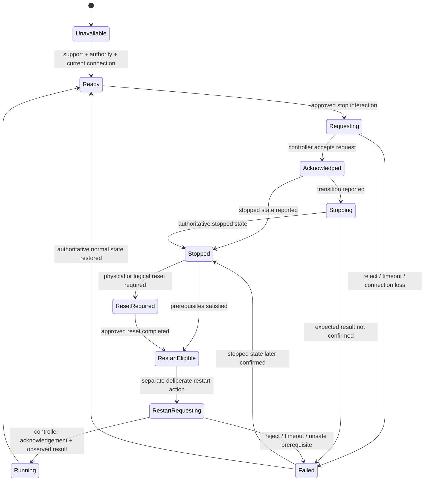

# ExRobotics safety-control UX draft

**Status:** Provisional; requires safety-engineering review  
**Version:** 0.1  
**Date:** 2026-08-20  
**Scope:** Interaction and information requirements only. This document does
not specify or certify a safety function.

## 1. Why this is separate

The requested `safety stop` cannot be treated as a normal red button added to a
header. Its correct name, availability, response, reset, and restart behavior
depend on the robot's risk assessment, electrical and control architecture,
certified safety functions, and operating context.

The UI may present authoritative safety state and may eventually initiate an
approved command. A browser interface is not safety-rated merely because its
control is visually prominent.

Until the underlying function is classified, all designs should use the
working label **Safety stop — terminology pending** in annotations and avoid
the phrase **Emergency stop** on an interactive software control.

## 2. Standards context and limits

- [ISO 13850:2015](https://www.iso.org/standard/59970.html) specifies functional
  requirements and design principles for emergency-stop functions on
  machinery. ISO lists the 2015 edition as current after review in 2020.
- [IEC 60204-1:2016](https://webstore.iec.ch/en/publication/26037) covers
  electrical, electronic, and programmable electronic equipment of machines
  and includes requirements concerning safe torque off, emergency stop, and
  control-circuit protection.
- [ISO 10218-1:2025](https://www.iso.org/standard/73933.html) covers safety
  requirements for industrial robots, while
  [ISO 10218-2:2025](https://www.iso.org/standard/73934.html) covers integration
  of industrial robot applications and cells. The ISO scope notes exclusions
  relevant to some mobile-platform uses, so applicability to ExRobotics must be
  established by qualified specialists rather than assumed.

These sources establish that emergency stopping belongs to a wider machine and
integration safety system. The public summaries are not enough to derive a
compliant implementation. The project needs its actual risk assessment,
applicable standards, safety requirements specification, and control-chain
design before the software behavior is finalized.

## 3. Classification decision required

Safety engineers and platform owners should classify the requested function as
one of the following before final UI naming or behavior:

| Candidate | Intended effect | UI implication |
|---|---|---|
| Operational stop | Normal controlled cessation through non-safety software | Present as a platform action; never call it emergency stop or imply a safety integrity level |
| Safety-function request | UI sends a request to a separately designed safety controller/function | Show command-path availability and authoritative acknowledgement; document whether the UI/transport is part of the safety function |
| Emergency-stop function/device | Complementary protective measure defined by the machine safety architecture | Do not emulate with ordinary UI styling or interaction; expose state and instructions only as approved by the safety design |

There may be more than one useful stop function. If so, each must have a
distinct name, consequence, authority, and lifecycle. One ambiguous `Stop`
control is unacceptable.

## 4. Safety UX principles

### 4.1 Truth before reassurance

- Show the state reported by the authoritative safety source.
- Never optimistically switch the UI to `Stopped` after sending a request.
- Keep request, acknowledgement, stopping progress, and observed stopped state
  distinct.
- State age and connection quality are part of the safety readout.
- If confirmation is unavailable, show `State unconfirmed`, not a neutral or
  healthy state.

### 4.2 Stop and restart are separate

- A stop request must never visually imply that releasing or resetting the
  condition restarts the robot.
- Restart is a separate intentional action with its own permission,
  prerequisites, scope, and acknowledgement.
- The UI should surface physical devices or interlocks that still require local
  action.
- A remote UI must not imply that it can reset a physical safety device unless
  the reviewed control architecture explicitly permits and verifies this.

This separation aligns with published machinery-safety guidance. For example,
[Pilz's standards FAQ](https://www.pilz.com/en-US/support/faq/standards/articles/180045)
summarizes that resetting an actuated emergency-stop device should prepare for,
not initiate, restart, and that restart requires a separate deliberate action.
The final ExRobotics behavior still requires its own risk assessment.

### 4.3 Urgent activation cannot depend on decorative friction

If the approved function is intended for urgent hazard response, its activation
pattern must be specified by safety engineering and tested for the actual
device, gloves, input method, connectivity, and failure modes. A generic modal
confirmation could delay action and must not be introduced merely because the
command is consequential.

Conversely, an operational stop or other high-impact but non-urgent action may
need scope confirmation. The classification determines the interaction.

### 4.4 Availability is explicit

The control needs observable answers to:

- Is this function supported on the active platform?
- Is the authoritative controller reachable?
- Is the user authorized?
- Is the current client/device allowed to initiate it?
- Which platform or safety zone will it affect?
- Is another stop source already active?
- Is the displayed state current enough to act on?

Disabled states must name the reason. Hiding the control can falsely suggest
that no stop capability exists.

### 4.5 Scope cannot be inferred

The active platform identity and affected scope remain adjacent to the control.
If the safety architecture contains zones or domains, the UI must state the
exact affected zone before action and show all active stop sources afterward.

## 5. Placement in the application shell

### Persistent header cluster

Place a compact safety cluster at the far right of the global header. It must
remain visible while pages, inspectors, or diagnostic drawers change.

The cluster contains:

- current safety state in text and icon;
- freshness/authority affordance;
- the approved stop control when available;
- a path to safety detail;
- an active-command or unacknowledged-state indicator.

Yellow remains the ExRobotics lead signal for current selection and action.
Safety severity should use the semantic danger treatment defined by the design
system, always paired with text and shape. The ExR yellow must not make a normal
selected element resemble a safety alarm.

### Overview summary

The Overview shows a safety instrument when:

- the safety state is abnormal;
- a stop is active or changing;
- state is stale or unavailable;
- a physical interlock or device needs attention;
- the user is reviewing the safety domain.

When safety is normal and current, it may reduce to a compact readout in the
header and posture summary. It should not occupy a large permanent card merely
to signal importance.

### Safety detail

The detail view may show, subject to the reviewed architecture:

- authoritative controller identity and connection;
- current state, state age, and source;
- stop category or safety function name as provided by the system;
- active stop sources and affected domains;
- interlocks, protective devices, and reset prerequisites;
- state-transition timeline;
- diagnostics and faults;
- user actions and audit history;
- approved recovery instructions.

Avoid visualizing a complete safety circuit from inferred data. Clearly label
configured, observed, and inferred relationships.

## 6. Provisional lifecycle

The UI state machine is intentionally more detailed than a binary running /
stopped status.

This is a UX draft, not the safety-controller state machine. Final labels must
map exactly to authoritative machine states.

## 7. Required presentation by state

| UI state | Primary message | Control behavior | Evidence |
|---|---|---|---|
| Unsupported | Stop function unavailable for this platform | disabled with explanation | platform capability source |
| No authority | You cannot initiate this function | disabled; show required role/process | user and policy source |
| Offline | Safety controller unreachable | no false current state; follow reviewed fallback guidance | endpoint, last seen, age |
| Stale | Safety state is out of date | restrict action according to policy | timestamp and expected cadence |
| Ready | Function available; current platform named | approved activation pattern | controller, scope, freshness |
| Requesting | Stop request sent; result not yet confirmed | prevent duplicate requests; keep other stop sources visible | requester, request ID, time |
| Acknowledged | Controller accepted request | show transition without declaring stopped | acknowledgement source and time |
| Stopping | Platform transition in progress | preserve stop state and affected scope | observed stages, timeout policy |
| Stopped | Authoritative stopped state confirmed | separate recovery path | cause/source, affected scope, time |
| Reset required | Local or system prerequisite remains | no restart control until eligible | exact prerequisite and owner |
| Restart eligible | Preconditions reported satisfied | separate restricted restart action | prerequisite checks and freshness |
| Failed/unknown | Requested result not confirmed | prominent unresolved state and approved next step | rejection/timeout/connection evidence |

## 8. Activation interaction: decision tree

The first Figma draft should not pick a confirmation pattern until this decision
tree is resolved:

1. Is the function for urgent hazard response?
   - If yes, safety engineering specifies a direct activation pattern that does
     not introduce unreviewed delay.
   - If no, continue as a consequential platform action.
2. Is the client and command path part of the validated safety function?
   - If no, label it according to its actual non-safety role and communicate
     limitations.
3. Can the action affect more than one zone or platform?
   - If yes, exact scope is mandatory and broad action needs specific review.
4. Does the action require press-and-hold, two-step activation, physical
   presence, or a hardware control?
   - Implement only the reviewed requirement; do not improvise from visual
     conventions.
5. What must happen if acknowledgement is delayed or connectivity fails?
   - Show unresolved state and the approved fallback instruction. Never claim
     success from the outgoing request alone.

## 9. Recovery, reset, and restart

Recovery is deliberately slower and more explicit than stop activation.

The interface should present a checklist derived from authoritative state, for
example:

- stop source identified;
- hazard or initiating condition addressed;
- physical emergency-stop device released locally, if applicable;
- interlocks and protective devices satisfied;
- controller faults cleared through the approved process;
- affected area checked according to operating procedure;
- reset eligible;
- restart separately authorized.

The UI must distinguish:

- **release** of a physical device;
- **reset** or acknowledgement of a safety function;
- **fault reset**;
- **enable** or preparation to run;
- **restart/start** of motion or operation.

These are not interchangeable labels, and some may not be available remotely.

## 10. Audit requirements

For every software-visible safety event or action, retain and display where
available:

- active platform and affected domain;
- authoritative controller and source;
- function name and requested operation;
- requester identity, role, and client;
- request time, acknowledgement time, and observed-result time;
- request and correlation IDs;
- starting and resulting state;
- rejection, timeout, or failure reason;
- active physical/interlock source;
- reset and restart actions as separate records;
- data freshness and clock source.

Audit presentation must not imply forensic certainty when sources have clock
skew, gaps, or conflicting observations.

## 11. Failure scenarios to prototype

The design review must include more than the happy path:

1. Control visible but user lacks permission.
2. Platform selector points to a disconnected robot.
3. Safety state becomes stale while the control is visible.
4. Request is sent but no acknowledgement arrives.
5. Controller acknowledges, but stopped state is not observed in time.
6. Connection drops during transition.
7. A physical emergency stop was already active before the software request.
8. Multiple stop sources are active.
9. Stop succeeds for one domain but another source is unknown.
10. Reset is attempted while a physical device remains actuated.
11. Reset completes but restart is not authorized.
12. Restart request is rejected because a prerequisite changed.
13. Event timestamps disagree across controllers.
14. User changes platform context while a request is unresolved.
15. Two users initiate or recover the same platform concurrently.

Unresolved actions should pin the affected platform context and require an
explicit handoff before the user can mistake another platform's state for the
current result.

## 12. Content rules

- Use the exact approved safety-function name, not a convenient synonym.
- Name the affected platform in every modal, banner, and notification.
- Prefer `Request sent — stop not yet confirmed` over `Stopping…` when only the
  request is known.
- Prefer `Stopped state confirmed by <source>` over a generic `Success`.
- Prefer `State unavailable` over leaving the previous state visible without a
  stale marker.
- Give recovery instructions only when they come from an approved procedure.
- Do not use celebratory success visuals for a safety event.
- Do not make red a substitute for explanation.

## 13. Accessibility and input

- State is always conveyed through text, icon, and where useful shape/pattern.
- The control and all recovery actions use at least a 44 x 44 px target.
- Focus order keeps platform identity, safety state, control, and status
  feedback adjacent.
- Screen readers receive state transitions through an appropriate live region
  without repetitive announcements.
- Keyboard activation follows the reviewed interaction; no safety-critical
  behavior may depend only on hover, drag, or color.
- Motion is restrained and may be disabled; persistent state replaces
  transient animation.
- The interaction must be tested with the actual workstation, touchscreen,
  gloves, and environmental conditions if those are intended contexts.

## 14. Review gates before Figma implementation

The safety-control component should not be finalized until the team answers:

1. What safety or operational function is being requested?
2. What standard and risk assessment apply to this robot and use context?
3. Is the UI or its transport inside the safety-related control system?
4. What controller is authoritative for availability, acknowledgement, and
   stopped state?
5. What is the exact affected scope?
6. Who may initiate, reset, enable, and restart?
7. Which steps require physical presence or local visibility?
8. What are the allowed interaction and confirmation patterns?
9. What are the acknowledgement and transition timeouts?
10. What fallback instruction is approved for every connection/failure state?
11. What audit and retention requirements apply?
12. Which final terms are legally and technically approved?

## 15. Figma draft after review

Create one component family and one lifecycle specimen covering:

- ready/available;
- unsupported;
- no permission;
- offline and stale;
- requesting;
- acknowledged;
- stopping;
- stopped;
- reset required;
- restart eligible;
- restart requesting;
- rejected, timed out, and unconfirmed.

The specimen should demonstrate persistent-header placement, Overview abnormal
state, safety detail, action feedback, and audit trace. It should use synthetic
engineering data and include the underlying source and freshness in every
state.

