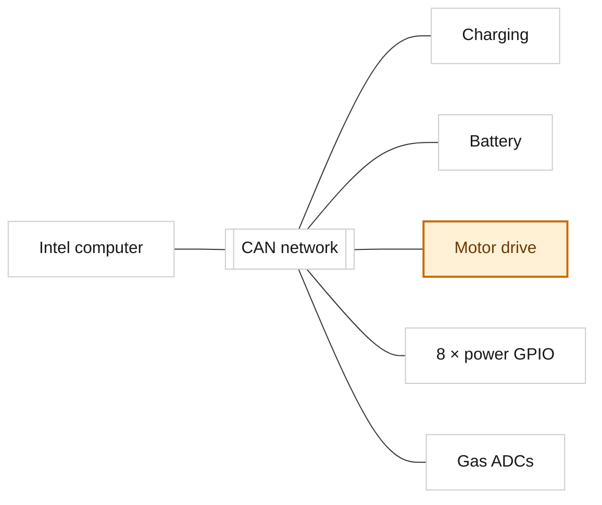

# System visualization and layout specification

**Status:** Initial design-input specification  
**Version:** 0.1  
**Date:** 2026-08-20  
**System facts:** `PLATFORM_SYSTEM_MODEL.md` and
`../data/platform-system.yaml`

## 1. Objective

The interface should externalize the platform's structure so an engineer does
not have to reconstruct it from labels. Whenever state depends on location,
attachment, flow, redundancy, or causality, use an accurate schematic before a
text list.

The default question is:

> What changed, where is it, how does it propagate, and what evidence supports
> that conclusion?

Text remains essential for exact names, values, reasons, and timestamps. It
annotates the visual model; it does not replace it.

## 2. Cognitive-ergonomics rules

1. **Stable geography:** keep the Intel node, Jetsons, LAN spine, CAN branch,
   and subsystem positions stable across related views.
2. **One visual focus:** one selected or degraded path dominates; unrelated
   nodes recede without disappearing.
3. **Progressive disclosure:** show topology at Glance, attached facts at
   Investigate, and raw messages/logs at Evidence.
4. **State in place:** put health on the represented object or edge, not in a
   detached status card.
5. **Paths before prose:** show dependency or signal propagation as a path;
   explain the path in an adjacent inspector.
6. **No false precision:** dashed placeholders and `TBD` labels are preferable
   to invented camera hosts, VRRP roles, or network routes.
7. **Preserve comparison:** the three compute nodes should remain simultaneously
   visible when comparing resources, containers, time, or connectivity.
8. **Limit simultaneous edge types:** default to one primary relationship
   layer; reveal other layers on demand.

## 3. Canonical spatial grammar

The platform overview should use this repeatable geography:

- **top / outer boundary:** fleet-manager integration, Tailscale, WiFi and
  cellular;
- **upper middle:** shared-uplink ownership and failover;
- **center:** a strong horizontal LAN spine;
- **center row:** Intel, Jetson 1, Jetson 2 as comparable compute objects;
- **lower branch under Intel:** CAN and its attached subsystems/I/O;
- **side attachment zone:** cameras until their actual host/transport is known;
- **inside compute nodes or in a software overlay:** Docker containers;
- **cross-cutting overlay:** chrony relationships and measured clock offset.

```text
┌──────────────────────── External / secure boundary ────────────────────────┐
│ Fleet-manager integration     Tailscale       WiFi       4G/5G             │
└───────────────────────────────┬─────────────────────────────────────────────┘
                                │
                       Uplink ownership / VRRP
                                │
════════════════════════════ On-board LAN ════════════════════════════════════
          │                         │                         │
   ┌──────┴──────┐           ┌──────┴──────┐           ┌──────┴──────┐
   │ Intel       │           │ Jetson 1    │           │ Jetson 2    │
   │ containers  │           │ containers  │           │ containers  │
   └──────┬──────┘           └─────────────┘           └─────────────┘
          │ CAN                                  Cameras: attachment TBD
   ┌──────┼──────────┬──────────┬──────────┐
 Charging Battery  Motor      8× power    Gas ADCs
                   drive      GPIO
```

This arrangement is a mental-map contract, not a decorative diagram. Focused
views may zoom into it, but should not arbitrarily rearrange the same objects.

## 4. Visual encoding contract

### Objects

| Object type | Shape treatment | Minimum visible information |
| --- | --- | --- |
| Compute node | substantial rectangular enclosure | name, architecture, health, load, clock freshness |
| LAN or CAN | spine/bus with labeled attachment points | link/bus identity, state, errors, freshness |
| Physical subsystem | compact equipment tile or schematic symbol | name, health, power/connection state |
| GPIO bank | eight-channel matrix, not one generic tile | channel identity, requested and observed state |
| Camera | camera glyph plus stream/control indicators | attachment, stream state, PTZ state if applicable |
| Container | compact process capsule inside a host lane | name, owner, state, version/restart fact |
| External integration | boundary node outside chassis | API/agent mode and path health |
| Unknown attachment | dashed node/edge with `TBD` | the exact missing fact |

### Relationships

| Relationship | Line treatment |
| --- | --- |
| Physical cable/bus membership | solid line |
| Network path | solid line with direction only when meaningful |
| Logical dependency | dashed line |
| Tailscale/VPN overlay | dotted or double-outline tunnel |
| Time synchronization | thin clock-marked edge |
| Observed traffic | optional animated/current trace over a known path |
| Unknown association | dashed neutral line ending in a question marker |

Do not use animated flow when there is no live measurement.

### Color and non-color state

- **ExR yellow:** selection, active scope, current datum, active path, or
  deliberate primary action.
- **Orange:** degraded/warning state and the affected path.
- **Red:** fault or unavailable required function.
- **Green:** healthy confirmation, used quietly.
- **Neutral grey:** normal structure.
- **Muted/dashed/hatching:** stale, unknown, offline, or inferred states,
  always paired with a label or icon.

Selection and warning are different. A selected healthy subsystem is yellow; a
degraded subsystem is orange. If the degraded subsystem is selected, use a
yellow focus bracket around the orange status treatment rather than replacing
one meaning with the other.

## 5. Example: degraded subsystem in place

The following is a presentation example, not a claim about current robot
health.



In the product UI, the motor-drive node and the relevant CAN path become
orange, an adjacent inspector states the reason and freshness, and unrelated
objects remain legible but visually quiet. This is faster to parse than a list
containing the sentence “motor drive degraded.”

## 6. View recipes

### A. Platform Overview

Primary instrument: a 8-column platform schematic using the canonical spatial
grammar. Adjacent 4-column causal-issue/selection inspector.

Required visible layers:

- external-link posture;
- LAN and three compute nodes;
- Intel-to-CAN branch and named subsystem objects;
- camera objects with truthful attachment state;
- highest-impact abnormal object and propagation path;
- global data freshness and clock-correlation confidence.

Secondary row:

- compute-resource comparison across all three nodes;
- uplink ownership/failover state;
- recent change or correlated-event timeline.

### B. Compute

Keep the three computers aligned as lanes. Expand the selected computer while
preserving the others for comparison. Show:

- CPU/GPU, memory, storage and thermal instruments;
- Docker container placement and ownership;
- container-to-network/subsystem dependencies;
- chrony state and offset;
- selected container/process evidence.

### C. Connectivity

Use a layered path view rather than independent interface cards:

`WiFi / cellular → keepalived/VRRP owner → LAN → compute node → CAN or service`

Tailscale is a separate overlay layer, not drawn as a physical cable. Surface:

- active and standby uplink;
- VRRP role/priority and most recent transition;
- link rate, latency, loss, errors, and freshness;
- routes/peers only when authoritative data exists;
- the selected end-to-end path.

### D. Subsystems

Use the CAN spine as the central instrument. Arrange charging, battery,
motor-drive, GPIO, and gas ADC objects at stable attachment points. The
selected subsystem expands into state-machine, power, measurement, event, and
configuration details.

The GPIO bank must be an eight-channel matrix. Each channel needs separate
requested state, observed state, affected power domain, permission, and
interlock presentation once those facts are known.

### E. Software

Use three host lanes containing container groups. Group by owner
(ExRobotics/partner) without relying on color alone. Edges reveal selected
dependencies, ports, hardware ownership, and external integration. Avoid an
undifferentiated container table as the primary view.

### F. Time and evidence

When investigating multi-node events, show a chrony synchronization strip
above the shared timeline. Offset, uncertainty, and stale/unsynchronized states
must be visible before the UI presents causal ordering as reliable.

## 7. Layout construction guidance

At the 1,440 px reference width:

- retain the documented global header and 224 px context navigation;
- use the remaining 12-column workbench;
- allocate 8 columns to the primary schematic and 4 to the inspector or causal
  issue stack;
- allow the schematic 420–560 px depth so labels and relationships remain
  readable;
- use 12–16 px external gutters but smaller internal diagram gaps;
- keep system nodes inside one low-relief instrument surface instead of
  scattering them across unrelated cards;
- attach evidence in the bottom diagnostics drawer without moving the system
  geography;
- use floating tiles only for selected details, annotations, or temporary
  controls.

Do not implement every domain in one overview. The stable platform diagram is
the anchor; filters or focus modes select physical, network, software, time, or
integration overlays.

## 8. Interaction model

- Selecting any visual node opens the same canonical object inspector.
- Hover may preview direct neighbors but cannot contain essential facts.
- Selecting an issue focuses the responsible node and affected path.
- A layer control switches between physical, connectivity, software,
  synchronization, and integration relationships.
- Zoom or expand preserves node positions and the selected object.
- A “why?” disclosure states which measurements caused a health roll-up.
- Raw evidence opens with the selected object, path, and time window preserved.
- Camera selection exposes diagnostic stream/PTZ state only; it does not imply
  driving or mission control.

## 9. Acceptance checks for future layouts

A layout is not ready for visual styling until:

1. the three compute nodes, LAN, Intel/CAN relation, and subsystem branch can be
   understood without reading paragraphs;
2. a single orange degraded subsystem is identifiable in under two seconds;
3. selection remains distinguishable from warning without color;
4. physical, logical, VPN, and unknown edges cannot be mistaken for each other;
5. camera attachment uncertainty is honest;
6. the selected object's evidence is reachable without losing the topology;
7. stale or unsynchronized time prevents overconfident causal presentation;
8. the view remains platform engineering—not fleet, mission, autonomy, mapping,
   navigation, or teleoperation.
