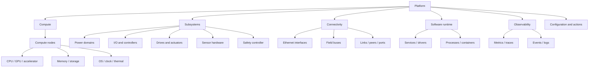
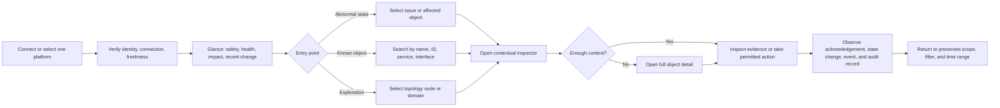

# ExRobotics engineering interface UX architecture

**Status:** Architecture baseline; task-led revision implemented  
**Version:** 0.3  
**Date:** 2026-08-20  
**Authority:** Product structure, information architecture, user flows, and
layout intent. Visual styling remains governed by `DESIGN_GUIDELINES.md`.
Actual robot inventory and topology are governed by
`PLATFORM_SYSTEM_MODEL.md`; visual topology composition is governed by
`SYSTEM_VISUALIZATION_SPEC.md`. Detailed capabilities and functional
requirements are governed by `UI_FUNCTIONAL_REQUIREMENTS.md`.

> **Implemented revision:** `INTERFACE_REDESIGN_PLAN.md` replaces the earlier
> category-led destinations and permanently open detail regions with the
> task-led Inspect → Diagnose → Change flow. Where later sections in this file
> still describe the former six-destination shell, treat them as retained
> rationale rather than the current Figma composition.

## 1. Purpose

This document defines the first product and layout architecture for the
ExRobotics internal engineering interface. It precedes screen design in Figma.

The interface should let an engineer answer four questions quickly:

1. Is the connected robot platform healthy and safe to inspect?
2. If not, which object or dependency is responsible?
3. What evidence explains the condition?
4. Which permitted action can the engineer take, and did the platform
   acknowledge it?

The product is an engineering workbench, not a mission-control dashboard. Its
organizing concepts are platform objects, dependencies, machine state, and
diagnostic evidence.

## 2. Product boundary

### In scope

- one active robot platform and its identity, build, connection, and clock;
- compute nodes, processors, memory, accelerators, storage, and thermal state;
- electrical and mechanical subsystems exposed by the platform layer;
- power domains, controllers, drives, I/O, sensor hardware, and safety
  controller state;
- Ethernet, field buses, links, interfaces, ports, peers, routes, and errors;
- operating-system services, drivers, processes, containers, and versions;
- metrics, telemetry, events, logs, traces, and configuration;
- health, diagnostics, dependency and topology views;
- deliberate, permission-controlled platform actions;
- visibility of safety-related state and a provisional safety-stop control.

### Out of scope

- fleet overview, multi-robot dispatch, utilization, or assignment;
- mission planning, execution, routes, checkpoints, or task queues;
- autonomy state, behavior planning, SLAM, localization, or navigation;
- maps and geographic tracking;
- operator productivity or business analytics.

A target selector may exist for labs that connect to more than one robot, but
it changes the single active context. It must not become a fleet dashboard.

## 3. Operating assumptions to validate

These assumptions make an initial layout possible. They are not hidden product
requirements and should be checked with platform and safety engineers.

- The primary viewport is a 1440 px desktop or larger engineering workstation.
- Users often work while physically near a robot, but remote inspection is also
  possible.
- The interface can identify one active platform and expose a stable object ID
  for its nodes, services, interfaces, and subsystems.
- Health is computed from multiple observations and can be `unknown` or
  `stale`; absence of a fault is not automatically healthy.
- Most investigations begin from an abnormal state, a search result, or a
  known object.
- Logs and high-frequency traces need more space than summary status.
- Configuration and control permissions differ from read permissions.
- Any safety-related command path, terminology, authentication, and reset
  behavior requires a formal safety assessment before implementation.

## 4. Users and jobs

### Commissioning engineer

Needs to confirm that hardware, networks, drivers, and services appear in the
expected topology; compare actual and intended configuration; and resolve
bring-up failures.

### Platform or embedded engineer

Needs to correlate resource pressure, process state, device events, timing,
interfaces, and dependencies without reconstructing the platform from separate
tools.

### Service and diagnostics engineer

Needs a fast health overview, durable evidence, version and identity details,
guided drill-down, and an auditable record of changes or actions.

### Safety-authorized engineer

Needs unambiguous visibility of safety-chain state and carefully restricted
controls. This role does not make the general UI or a browser connection
safety-rated.

### Shared jobs to be done

- orient to the exact platform, software build, and data freshness;
- notice the most consequential abnormal state before minor warnings;
- see affected dependencies, not just an isolated alarm;
- move from symptom to object to evidence with minimal navigation;
- compare current values with limits, history, and expected configuration;
- take an authorized action without confusing request, acknowledgement, and
  physical result;
- copy or export an investigation context for another engineer;
- return to the previous scope without losing filters or time range.

## 5. System object model

The UI should use one consistent object model across navigation, search,
topology, inspector, events, and configuration.

The generic model below is instantiated for the current robot in
`PLATFORM_SYSTEM_MODEL.md` and `../data/platform-system.yaml`. Those sources
currently define three compute nodes, a shared LAN and redundant internet
uplink, an Intel-attached CAN domain, five CAN-side subsystem/I/O groups, two
cameras, Docker workloads, chrony time synchronization, Tailscale, and an
external fleet-manager integration boundary. Designs must use those facts and
must preserve their explicit unknowns.



### Relationship vocabulary

Every relationship view should use a limited, reusable vocabulary:

- `runs on` — software to compute host;
- `depends on` — runtime or subsystem dependency;
- `connected by` — physical or logical link;
- `publishes to` / `subscribes to` — observable message relation;
- `powers` — power-domain relation;
- `controls` — controller-to-device relation;
- `reports through` — telemetry or event source path;
- `contains` — stable ownership or hierarchy.

The UI must distinguish physical topology, logical dependency, and observed
traffic. They may be layered in one stage, but never silently conflated.

### Object identity contract

Each inspectable object should expose:

- human-readable name and stable machine ID;
- type and parent scope;
- current state and health explanation;
- last observation time and data source;
- build, firmware, driver, or configuration version when relevant;
- upstream and downstream relationships;
- available evidence and permitted actions.

## 6. State and evidence model

### Health vocabulary

Use one platform-wide health model:

| State | Meaning | Required presentation |
|---|---|---|
| Healthy | Observations are current and within defined limits | text + icon; quiet treatment |
| Degraded | Function remains available with reduced margin or quality | reason + affected scope |
| Fault | Required function is unavailable or beyond a fault threshold | cause/evidence + consequence |
| Unknown | Health cannot be determined | reason and missing evidence |
| Offline | Expected object or data source is not connected | last seen + connection path |
| Stale | Data exists but is older than its validity window | age + expected cadence |

Do not use `healthy` when the actual state is merely `no reported faults`.
Status must never depend on color alone.

### Severity and health are separate

An event has severity; an object has health. A warning event may not degrade an
object, and one critical fault may affect many objects. The interface should
show the causal object once and roll up its impact rather than duplicating the
same alarm across every dependent tile.

### Data freshness is first-class

The active platform, every detail view, and every safety-related state must show
freshness. Stale data changes the interpretation of all other status and should
be surfaced before lower-priority warnings.

## 7. Information architecture

### Primary destinations

1. **Overview** — platform posture, prioritized problems, topology, and recent
   change.
2. **Hardware** — compute, storage, power/thermal, controllers, I/O, drives,
   and sensor hardware.
3. **Connectivity** — network interfaces, field buses, ports, peers, traffic,
   latency, loss, and errors.
4. **Software** — services, drivers, processes, containers, versions, resource
   ownership, and dependencies.
5. **Observability** — events, logs, traces, saved time ranges, and correlation.
6. **Configuration** — actual versus intended settings, changes, permissions,
   and platform actions.

### Safety placement

Safety is not merely another page in the navigation. It has three expressions:

- persistent global state and the provisional stop control in the application
  header;
- a safety summary on Overview when it is relevant or abnormal;
- a dedicated safety detail reached from either surface, showing safety-chain
  observations, inputs, causes, and audit history.

The control lifecycle is specified separately in `SAFETY_CONTROLS.md`.

### Local navigation

Destination pages use the same local sections when applicable:

- Summary;
- Metrics;
- Dependencies;
- Events;
- Logs;
- Configuration.

These should be stable local tabs or a compact sub-navigation, not a different
page taxonomy for every object type.

## 8. Primary user flow



### Flow principles

- A user should reach a specific object from Overview in one selection and its
  full detail in at most one additional action.
- Selecting a tile, row, trace datum, or topology node opens the same object in
  the inspector.
- The inspector preserves the workbench beneath it. Full-page navigation is
  reserved for analysis that genuinely needs more space.
- Time range, platform scope, and relevant filters persist through drill-down
  and back navigation.
- Actions show request, acknowledgement, observed result, and audit as separate
  facts.

## 9. Application shell

The shell is both product navigation and an orientation instrument.

### Region A — global header, 56–64 px

Persistent content:

- ExRobotics product mark at low visual priority;
- active platform selector and immutable ID affordance;
- connection and freshness state;
- global search / command entry;
- user identity and permission context;
- persistent safety state and provisional safety-stop control.

The header must remain visible while the workbench scrolls. The platform name
and connection state cannot disappear during a diagnostic action.

### Region B — context navigation, 208–248 px

- six primary destinations;
- compact domain disclosure when a destination contains important subgroups;
- live counters only for actionable abnormal items;
- settings and environment utilities at the bottom;
- collapses before the analytic workbench becomes too narrow.

The first draft uses one context-navigation panel. A second utility rail should
be added only if genuine global tools emerge.

### Region C — workbench

- compact page header with title, scope, time range, and relevant actions;
- 12-column mixed-span grid;
- 24–32 px padding and 12–16 px gutters;
- at least one relationship or analytic instrument above the fold;
- vertical scrolling for the page; local scrolling only for logs, tables, or
  large pannable stages.

### Region D — object inspector, 360–420 px

The inspector is attached to the right edge of the chassis and may overlay or
compress the workbench depending on width.

It contains:

- identity, state, and freshness;
- compact causal explanation;
- key metrics and thresholds;
- upstream/downstream dependencies;
- recent events;
- permitted quick actions;
- `Open full detail`.

It must have a visible anchor to the selected object and a predictable close
action. Opening it must not reset the underlying page.

### Region E — diagnostics drawer, 240–360 px high

An attached bottom drawer supports logs, traces, event detail, and command
output while preserving the selected object above. It may be resized and
collapsed. The drawer should inherit current scope and time range rather than
asking the user to reconstruct filters.

### Reference desktop allocation

At 1440 px, a practical starting point is:

- 24–32 px viewport inset when the host allows it;
- 224 px context navigation;
- 8–12 px navigation-to-workbench seam;
- remaining width for the 12-column workbench;
- 384 px inspector as an overlay at the reference width, or a compressed split
  view on larger displays.

These are starting constraints, not new visual tokens. Exact geometry should
be tested in Figma after the architecture is approved.

## 10. Information-density strategy

The product uses three layers of disclosure:

1. **Glance** — platform posture, freshness, consequential problems, and major
   dependencies.
2. **Investigate** — object inspector, comparative lists, traces, topology, and
   correlated events.
3. **Evidence** — full detail, raw logs, configuration diffs, and audit history.

### Rules for an efficient overview

- Put no more than five high-priority instruments above the fold.
- Let one large relationship stage dominate instead of opening with a uniform
  row of generic metric cards.
- Summarize healthy domains; spend visual area on abnormal or changing state.
- Rank problems by platform impact, then urgency, confidence, and recency.
- Group repeated symptoms under one causal issue when evidence supports it.
- Show comparisons in aligned rows or matrices, not a cloud of small cards.
- Use empty space inside a focused instrument, not as unused bands between
  modules.
- Keep raw logs out of the glance layer; reveal a compact event summary and
  open evidence in the drawer.
- Surface `unknown`, `offline`, and `stale` as meaningful states.

### Attention budget

At any moment, the shell should have one primary attention owner:

- an abnormal safety state;
- the selected object or path;
- an action awaiting acknowledgement;
- otherwise the highest-impact platform issue.

Yellow selection, animation, elevation, and alert treatment must not compete
across multiple unrelated elements.

## 11. Initial page compositions

### 11.1 Platform Overview

The first viewport should answer “what needs attention and where is it?”

```text
┌─────────────────────────────────────────────────────────────────────────┐
│ Global header: platform · connection · freshness · search · safety     │
├──────────────┬──────────────────────────────────────────────────────────┤
│ Context nav  │ Page header: Overview · scope · time range              │
│              ├───────────────────────────────┬──────────────────────────┤
│ Overview     │ Platform/dependency stage     │ Prioritized issues       │
│ Hardware     │ 8 columns                     │ 4 columns                │
│ Connectivity ├───────────────────────────────┼──────────────────────────┤
│ Software     │ Resource + thermal history    │ Subsystem posture        │
│ Observability│ 8 columns                     │ 4 columns                │
│ Configuration├───────────────────────────────┴──────────────────────────┤
│              │ Recent change / correlated events · 12 columns          │
└──────────────┴──────────────────────────────────────────────────────────┘
```

The topology stage shows compute, major subsystems, and network fabric at a
legible abstraction. It is not a full schematic. Selecting a node or affected
path opens the inspector.

The issues instrument is a causal queue, not an unfiltered event feed. Each
item names the responsible object, impact, confidence, age, and affected
dependencies.

The resource history aligns CPU, memory, storage pressure, thermal margin, and
power events on one time axis so engineers can correlate them.

The subsystem posture instrument summarizes comparable subsystem rows and
expands only abnormal groups.

The final strip shows recent configuration, boot, deployment, connection, and
fault changes on the same timeline.

### 11.2 Domain overview

Hardware, Connectivity, and Software share a template:

- domain identity and aggregated posture;
- one large comparative matrix or topology;
- a ranked object table with stable columns;
- domain-specific trace or distribution;
- related events;
- contextual inspector.

The actual instrument changes by domain. Hardware favors resource/thermal
matrices, Connectivity favors link and path topology, and Software favors
runtime dependency and ownership.

### 11.3 Object detail

- compact object header with ID, parent, health, freshness, and versions;
- local sections: Summary, Metrics, Dependencies, Events, Logs,
  Configuration;
- 8-column main evidence area;
- 4-column context area for state explanation, thresholds, dependencies, and
  permitted actions;
- child objects open in the inspector unless the user deliberately changes
  full-page scope.

### 11.4 Observability explorer

- query and filter bar attached to the page header;
- synchronized time range across events, traces, and logs;
- primary evidence area with table/trace split;
- facets for source object, severity, health consequence, and data source;
- object inspector from any event row or trace series;
- permalink/export that preserves platform, scope, time, and filters.

### 11.5 Configuration and action view

- intended and current values shown together;
- source, owner, permission, and last-change metadata;
- proposed changes assembled as a reviewable diff;
- validation results before apply;
- explicit request, acknowledgement, observed result, rollback availability,
  and audit record;
- dangerous or safety-related actions use their own reviewed interaction model.

## 12. Reusable component inventory

### Shell and navigation

- global header;
- active-platform selector;
- connection/freshness indicator;
- context-navigation row and group;
- global search / command palette;
- page header and scope/time controls;
- object inspector;
- diagnostics drawer.

### Object and state

- object identity lockup;
- health/state marker with text and icon;
- freshness marker;
- causal issue row;
- dependency path and topology node;
- comparable-object row;
- version/build metadata block;
- permission and authority indicator.

### Evidence

- synchronized trace instrument;
- resource/thermal matrix;
- topology/dependency stage;
- event stream and event detail;
- log viewer;
- configuration diff;
- threshold/range marker;
- boot/state timeline;
- correlation annotation.

### Actions

- standard platform action;
- action review panel;
- acknowledgement progress;
- action result and failure state;
- audit record;
- safety-stop control and safety-state banner as a separate family.

## 13. Interaction conventions

- Single selection changes focus; it does not execute a command.
- Selecting any representation of an object produces the same inspector.
- Double-click is never required for an essential action.
- Hover may preview a relation but cannot carry essential information.
- Search accepts human names, stable IDs, addresses, interfaces, services,
  versions, and event identifiers.
- Deep links encode active platform identity, destination, object, time range,
  and relevant filters.
- Browser back restores the prior workbench and inspector state.
- Destructive or consequential changes are never hidden in row overflow menus.
- Every command exposes eligibility, permission, scope, and current connection
  before execution.
- The UI does not show success until the authoritative source acknowledges the
  request and the expected result is observed.

## 14. Empty, loading, disconnected, and partial states

These are designed states, not generic placeholders.

- **Connecting:** target and attempted endpoint are visible; previous data is
  labelled historical.
- **Disconnected:** controls are disabled according to policy; last known state
  remains visibly stale rather than disappearing.
- **Partial telemetry:** available evidence remains usable while missing
  sources and affected conclusions are named.
- **No abnormal issues:** show quiet confirmation plus last analysis time, not
  an empty alarm table.
- **No permission:** explain which capability is unavailable without exposing a
  control that appears broken.
- **Unsupported object:** show raw identity and available evidence rather than
  silently omitting it.
- **Clock mismatch:** warn when correlation across sources may be unreliable.

## 15. Responsive intent

### Large desktop

Use a split inspector without covering the main relationship stage when space
allows. Dense comparisons can retain stable columns.

### Reference desktop

Use an overlay inspector attached to the chassis and preserve enough of the
selected instrument to maintain context. Collapse navigation when the user
needs a wider analytic stage.

### Medium width

Collapse context navigation first, then move secondary controls into drawers.
Reflow 4-column instruments to 6 columns while keeping the primary stage wide.

### Mobile or service tablet

Mobile is a secondary inspection surface, not a compressed desktop console.
Prioritize identity, safety state, consequential issues, selected-object
summary, and a focused evidence view. Large topology becomes pannable. Complex
configuration and high-risk actions may be unavailable until explicitly
designed and validated for that context.

## 16. Initial Figma screen set after approval

No screen in this list should be implemented until this architecture and the
safety terminology have been reviewed.

1. Platform Overview — healthy/current.
2. Platform Overview — degraded, with causal issue and inspector open.
3. Compute node detail — resource pressure correlated with process and thermal
   evidence.
4. Subsystem detail — controller/device dependency and recent state timeline.
5. Connectivity overview — selected path, link errors, latency, and peers.
6. Observability explorer — synchronized events, logs, and traces.
7. Configuration change — diff, validation, acknowledgement, and result.
8. Safety-state and stop-control lifecycle — all approved states.
9. Disconnected/stale/partial-permission states.

The healthy and degraded overview variants should be designed first. Together
they test hierarchy, density, selection, inspector behavior, and failure
communication before the component set expands.

## 17. Phased design plan

### Phase A — validate product model

- confirm user roles, object hierarchy, relationship vocabulary, and health
  ownership;
- identify authoritative sources for connection, freshness, health, and safety;
- review which actions exist and who may invoke them;
- resolve the meaning and implementation boundary of `safety stop`.

### Phase B — layout foundation

- prototype the shell, header, context navigation, workbench, inspector, and
  diagnostics drawer at large, reference, and medium widths;
- test long names, many issues, stale data, and an open inspector;
- validate that the primary analytic stage remains useful above the fold.

### Phase C — overview and drill-down

- compose healthy and degraded Overview variants;
- connect topology, issue queue, row selection, and search to one inspector;
- test time/filter persistence through full object detail.

### Phase D — evidence and configuration

- build domain and object-detail templates;
- define synchronized events/logs/traces behavior;
- design configuration diff, validation, acknowledgement, result, and audit.

### Phase E — safety control

- incorporate the reviewed safety architecture and terminology;
- prototype all control, acknowledgement, stopped, reset-ready, restart, fault,
  offline, and permission states;
- conduct formal safety, accessibility, and usability review.

### Phase F — visual identity and componentization

- apply Signal Instrumentation after layout behavior works without color;
- create variables, components, variants, and responsive properties;
- run reference-fidelity, density, contrast, interaction, and content audits.

## 18. Evaluation criteria for the initial draft

The layout succeeds when representative engineers can:

- identify the active platform, connection, and freshness in under five
  seconds;
- find the most consequential abnormal condition without reading every tile;
- name the responsible object and at least one affected dependency from the
  overview;
- reach supporting events, logs, or traces without losing the selected scope;
- distinguish current fact, inferred health, requested action, acknowledgement,
  and observed result;
- understand whether a control is available and why;
- complete the flow without encountering fleet, mission, mapping, navigation,
  or autonomy concepts.

## 19. Open product questions

1. What exact platform objects and stable IDs are available today?
2. Which source owns rolled-up health, and which health states already exist?
3. What freshness windows apply to telemetry, events, and safety state?
4. Which relationships can be observed versus inferred from configuration?
5. Which platform actions exist beyond stop, and are they reversible?
6. What does `safety stop` mean in the current control architecture?
7. Is the intended software stop safety-rated, operational only, or a request
   to a separate safety controller?
8. Where may a stop be initiated, acknowledged, reset, and restarted?
9. What authentication, authorization, physical presence, and audit rules
   apply?
10. Which viewport and input device are used during commissioning and service?
11. Which evidence must be exportable for support and incident review?
12. How should the interface behave when platform time sources disagree?

## 20. Non-goals for the first draft

- final visual polish or color application;
- exhaustive configuration editors;
- a complete electrical schematic or message graph;
- predictive maintenance scoring;
- alert-management workflow for a fleet;
- mobile parity;
- any claim of standards compliance or safety integrity.
